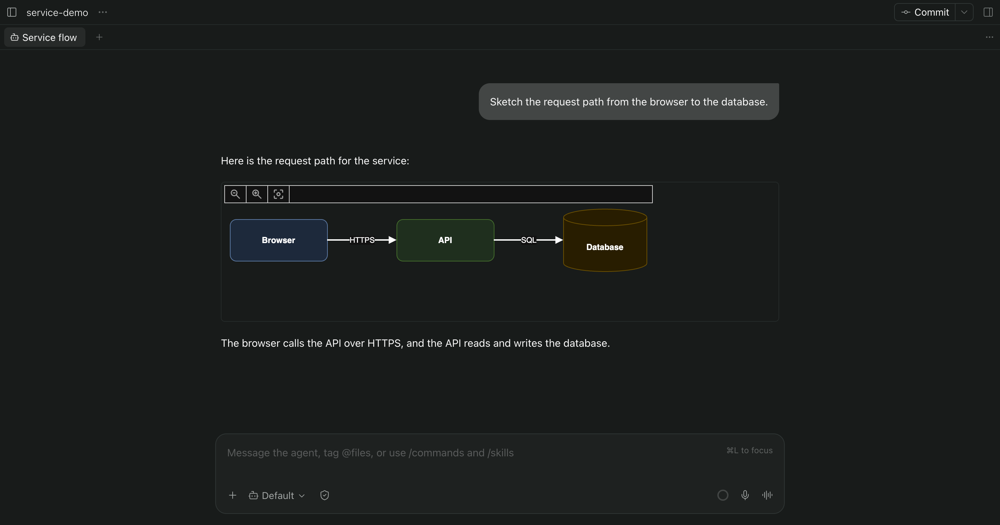
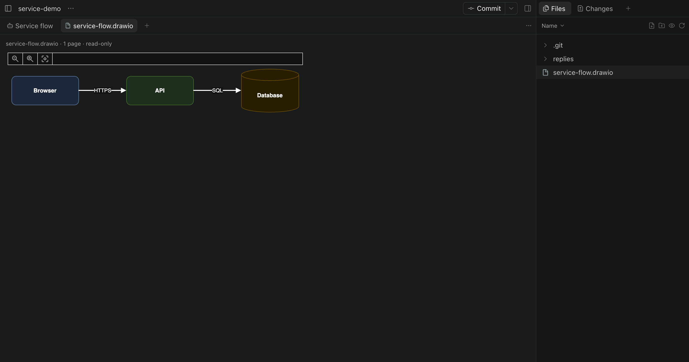

# draw.io for Paseo

View draw.io diagrams in Paseo file tabs and agent replies. Ask your agent to create or update diagrams using the official draw.io tools.



## Features

- Open `.drawio` files in a read-only panel with page selection and zoom. The panel follows changes on disk.
- Render fenced `drawio` blocks directly in assistant replies, including multiple diagrams per reply.
- Use `/drawio <request>` to ask the current agent for a diagram.
- Give Claude, Codex and OpenCode agents tools to read and replace diagram pages, search shapes, and prepare XML with label fitting and optional layout and edge routing.



## Requirements

Paseo 0.15.0 or later on the daemon and client, with plugins enabled. Rendering works in the desktop app and web browsers; native iOS and Android clients show a notice instead. Tool integration requires a supported agent provider and Node.js/npm on the daemon's path.

## Install from GitHub

```sh
paseo plugin add git:ivolnistov/paseo-plugin-drawio
```

The Git installation installs locked production dependencies without dependency lifecycle scripts. It also attempts to download the pinned official ELK layout bundle from GitHub into a private user cache. A failed ELK download leaves layout unavailable; the other preparation steps remain usable.

For a local checkout:

```sh
npm ci --omit=dev --ignore-scripts
npm run prepare-elk
paseo plugin install /absolute/path/to/paseo-plugin-drawio
```

## Try it

Open [the example diagram](examples/service-flow.drawio) from a Paseo workspace. Choose **draw.io** if Paseo asks how to open the file.

In an idle agent chat, try:

```text
/drawio Draw a service flow: a browser calls an API, and the API reads a database. Show the diagram in your reply.
```

The agent can show a diagram in a fenced `drawio` block or save a `.drawio` file in the workspace. Viewing is read-only; changes to a saved diagram are made by the agent. `/drawio` refuses requests while the current agent is busy.

## Data and network

The bundled draw.io viewer runs in a sandboxed frame with network access blocked. External images, web fonts and remote stencils are not loaded, and diagram links do not open. Shape search uses a shipped local index.

ELK setup downloads code from the pinned draw.io release on GitHub and verifies its SHA-256. Edge routing uses the routing library bundled in the official `@drawio/mcp` package and downloads nothing. Diagram content read or written by an agent enters that agent's conversation and is sent to its model provider like other tool results.

Sources larger than 2,000,000 characters and compressed pages expanding beyond 8,000,000 bytes are refused. Internal DTD entities are expanded on the daemon under additional limits; external DTDs, external entities and parameter entities are rejected. Older inline diagrams pause to limit memory use and can be shown again.

See [the listing overview](OVERVIEW.md) for the full behavior and limitations.

## Development

```sh
npm ci --ignore-scripts
npm run typecheck
npm test
npm pack --dry-run --ignore-scripts
```

The test command uses Node's experimental TypeScript transform flag. Use a Node release that supports `--experimental-transform-types`, such as Node 22.18; Node 26 has removed this flag.

## License

MIT for the plugin’s original code. Bundled third-party assets retain their own terms; see [NOTICE.md](NOTICE.md) and [licenses/](licenses/). draw.io stencils and icons carry an additional restriction described in the notice. The optional ELK bundle includes EPL-2.0 code; availability of its corresponding source has not been established, as documented in the notice.
